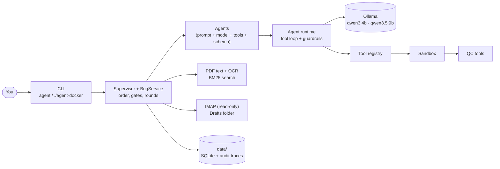
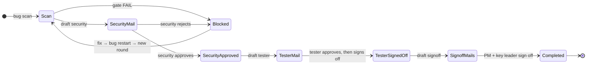

# AgentBuild

A local, multi-agent assistant for the **bug quality and release process**. It runs entirely on your own machine:
small open models on [Ollama](https://ollama.com) read ASoC security reports, PDFs and work mail, draft the process
mails, and track approvals and sign-offs for each bug.

- **Local only.** The models run in Ollama on your machine. The only outbound connection is IMAP to your own mailbox.
- **The model advises, code decides.** Step order, severity counts, the security gate, who may approve, and every
  tool permission are enforced by plain code. The model reads, summarises and drafts.
- **You approve every change.** Nothing is sent: drafts go to your Drafts folder, and every step a reply would
  complete asks you `y/N` first.

## What it does

| Area | What you get |
|---|---|
| **BUG quality process** | One isolated context per bug id: ASoC scan analysis → security team mail → security approval → tester mail → tester approval and sign-off → PM and key leader sign-off. A failed scan or a security rejection blocks the bug; you fix it and restart with the **same id** in a new round. |
| **PDF Q&A** | Ask questions about any PDF, including scanned ones (OCR). Every answer cites page numbers, and each quote is **checked against the real page text**. |
| **Mail** | Read-only triage (priority, summary, action items), reply drafts, and detection of approvals, sign-offs and rejections in replies. |
| **Release QC** | Runs your organisation's quality tools on a repository and returns **GO / NO_GO / NEEDS_REVIEW** by fixed rules. |

## How it works



- **Agents are configuration**, not code: each one in [`config/agents.yaml`](config/agents.yaml) is a prompt, a
  model role, a tool allowlist, an output schema and a time and step budget.
- **The runtime** ([`core/agent.py`](src/agentbuild/core/agent.py)) runs every tool call through
  *policy → your approval (if needed) → argument validation → run → redaction*. Final answers must match a JSON schema.
- **Untrusted text is quarantined.** Email, PDF and report text is sanitised and wrapped as data. The agents that
  read it have no tools, and a context that has held untrusted text can never start a process.

## Quick start (Docker, recommended)

Needs **Docker with Compose 2.24+**, git, about 25 GB of free disk, and an x86-64 machine. No Python or Ollama install needed.

```bash
git clone https://github.com/<you>/AgentBuild.git && cd AgentBuild
scripts/build.sh 1.0          # builds the app + an Ollama image with both models inside (~9 GB download, once)
cp .env.example .env          # optional: model choice, IMAP password, GPU on/off
./agent-docker doctor         # checks models, OCR, mail access and QC tools
```

Then use `./agent-docker <command>` for everything below. Put PDFs and ASoC reports in `files/` and repositories
in `repos/`. Your data stays in `data/`, which is not in git.

- **GPU or CPU is picked automatically.** With the NVIDIA container runtime the GPU is used. Without it, the CPU is used
  with longer time limits (see [Models and hardware](#models-and-hardware)).
- **Windows:** use Docker Desktop and run the commands in a WSL2 terminal.
- **Behind a proxy:** set `HTTPS_PROXY` in Docker's settings; the build passes it through.

## Quick start (native, for development)

```bash
# Ollama + models (Arch shown; see ollama.com for other systems)
sudo pacman -S ollama-cuda tesseract tesseract-data-eng
ollama serve &                                   # or: systemctl start ollama
ollama pull qwen3:4b && ollama pull qwen3.5:9b

python -m venv venv && ./venv/bin/pip install -e '.[dev]'
./venv/bin/agent doctor
```

## First-time configuration

Before using it for real work, replace the placeholders:

| File | Change |
|---|---|
| [`config/settings.yaml`](config/settings.yaml) | `mail.source: imap`, `mail.imap.host/user`, `mail.from_addr`, `bug.my_name`. **`bug.recipients`**: the real security team, tester, PM and key leader addresses. Only these addresses can approve or sign off. |
| [`config/bug_templates/`](config/bug_templates/) | Your organisation's mail formats. See the README there for the `{placeholders}`. |
| [`config/policies.yaml`](config/policies.yaml) | `qc_sender_allowlist`: who may request a QC run by email. |
| [`config/qc_tools.yaml`](config/qc_tools.yaml) | Your real QC tools. The shipped entries (syntax, pytest, ruff, gitleaks) are examples. |
| `.env` (Docker) | `AGENT_IMAP_PASSWORD`, and optionally model choices, `AGENT_GPU` and `TZ`. |

To put drafts straight into your mailbox, set `mail.draft_target: imap` and `mail.drafts_folder`
(Outlook: `Drafts`, Gmail: `[Gmail]/Drafts`). Otherwise drafts are saved as `.eml` files in `data/drafts/`.

> **Microsoft 365 / Outlook:** IMAP login currently uses an app password. Many company tenants have turned off
> password-based IMAP, and those need OAuth2 sign-in, which is not implemented yet. `agent doctor` tests the login.

## Usage

### BUG quality process

Every command takes the bug id (`BUG-12345`, or just `12345`).

```bash
agent bug new 12345 -t "Payments API order lookup fix" [--tester a@x.com --pm b@x.com --keyleader c@x.com]
agent bug scan BUG-12345 files/asoc-report.pdf    # counts, issues, security gate. FAIL => blocked
agent bug draft BUG-12345 security                # security team mail, ASoC PDF attached
agent bug sync BUG-12345                          # reads replies: the security team must approve
agent bug draft BUG-12345 tester
agent bug sync BUG-12345                          # tester approval, then tester sign-off
agent bug draft BUG-12345 signoff                 # PM + key leader mails
agent bug sync BUG-12345                          # both sign-offs => COMPLETED

agent bug status BUG-12345                        # timeline, rounds, and the exact next command
agent bug ask BUG-12345 "why was it blocked?"     # or: agent bug chat BUG-12345
```



- **Order is enforced.** For example, no tester mail before the security team approves. A reply that arrives early
  is kept and applied once its step is reached.
- **Blocked means restart.** Run `agent bug restart BUG-12345 --fix "what you fixed"`, then scan the new report.
  The previous round stays in the bug's history. Replies dated before the restart never count in the new round.
- **Same-thread re-submissions.** After a restart, the security mail goes out as a reply on top of the earlier
  thread, with a `Re:` subject, threading headers and their last mail quoted. The same happens whenever someone asks
  for it in a reply. Override with `--thread` / `--new-thread`.
- **Only listed senders count.** A "signed off" mail from any other address is shown as `ignored_sender`.
- **The security gate** (`bug.security_gate`) fails on any critical or high finding by default. Set every limit to
  `0` to fail on any finding at all.
- **Manual override:** `agent bug mark BUG-12345 pm_signoff --note "approved on a call"`. Undo with `bug reopen`.

**ASoC numbers are checked by code.** Severity counts, the report header and the Issue Types table are parsed
from the PDF text. The model's reading is only a fallback, and any disagreement is shown as a `check:` warning.
Verify the parser against one of your real reports first; it was built on an ASoC-style sample layout.

### PDF questions

```bash
agent pdf chat files/policy.pdf                  # interactive; the first use extracts and indexes the file
agent pdf ask policy "What is the minimum code coverage?"
agent pdf list | agent pdf remove <doc>
```

Small documents (under 12,000 characters) are sent whole. Larger ones send the best-matching passages, found by BM25
search over chunks that never span pages. Each citation is marked:

| Mark | Meaning |
|---|---|
| **verified** | the quote appears word for word on the cited page |
| **page corrected** | the quote is real but on another page; the page number is fixed |
| **close match** | at least 80% of the words match and every number matches exactly |
| **NOT FOUND** | not in the document; check the answer yourself |

Scanned pages are read with Tesseract OCR. Install extra languages and set `docs.ocr_lang`, e.g. `eng+tam`.

### Mail, QC and the rest

```bash
agent mail triage [--limit 10]           # read-only: priority, summary, tasks; offers QC for release requests
agent mail draft <uid> --say "..."       # reply draft, never sent
agent tasks                              # action items found in mail
agent qc run repos/my-service [--ref main]   # GO / NO_GO / NEEDS_REVIEW (exit code 0 only on GO)
agent ask "what's the status of bug 12345?"   # free text; the supervisor picks the command
agent runs list | agent runs show <run_id>    # audit trace of every model call, tool call and decision
```

A QC run on `--ref` uses a temporary git worktree, so your working copy is never touched. The verdict comes from
rules (a failed or skipped **blocker** check gives NO_GO, a failed **major** check gives NEEDS_REVIEW). The model only
writes the explanation.

## Models and hardware

| Role | Default | Used for |
|---|---|---|
| `fast` | qwen3:4b | routing, mail triage, reading replies |
| `main` | qwen3:4b (qwen3.5:9b with a GPU) | PDF and bug questions, drafts, QC analysis |
| `quality` | qwen3.5:9b | ASoC analysis only: its summary goes into the security team mail |

On the same tasks both models answered every factual question correctly. The 9B model wrote a noticeably more
precise ASoC summary, so it is used only there. Qwen3 "thinking" is off (`ollama.think: false`), which is about
40× faster for structured answers.

Measured without a GPU (x86-64, 16 GB RAM, 16 threads):

| | Time | RAM |
|---|---|---|
| PDF question, model loaded | ~7 s | ~4 GB |
| ASoC scan (9B) | ~2 min | ~7 GB |
| First command after a model switch | +20–30 s | |

On weaker CPUs expect roughly 2–4× longer. Change the roles in `.env` (`AGENT_MODEL_MAIN`, `AGENT_MODEL_QUALITY`) or in
`config/settings.yaml`.

## Guardrails

| Guardrail | Where |
|---|---|
| Email, PDF and report text is sanitised, flagged for prompt injection, and wrapped as untrusted data. The agents that read it have no tools. | [`guardrails/input.py`](src/agentbuild/guardrails/input.py) |
| Tools have READ, WRITE or EXEC risk tiers and a per-agent allowlist. EXEC is refused once the context holds untrusted text. | [`guardrails/policy.py`](src/agentbuild/guardrails/policy.py) |
| No shell: commands are fixed argument lists, limited to allowed repo folders, with a scrubbed environment and timeouts. | [`guardrails/sandbox.py`](src/agentbuild/guardrails/sandbox.py) |
| Structured outputs with schema validation and retries. Secrets are redacted before logging. Step, tool-call and time budgets apply. | [`core/agent.py`](src/agentbuild/core/agent.py), [`guardrails/output.py`](src/agentbuild/guardrails/output.py) |
| Mail → QC requires an allowlisted sender **and** your approval. The QC agent never sees the email text. | [`core/supervisor.py`](src/agentbuild/core/supervisor.py) |
| In Docker, Ollama sits on an internal network with no internet and no open port. | [`compose.yaml`](compose.yaml) |

## Offline bundle (no internet on the target)

```bash
scripts/export.sh 1.0 /path/with/15GB      # images.tar + compose files + config + ./agent + ./install.sh
# copy the folder to the other machine, then:
./install.sh && ./agent doctor
```

`FLAVOR=gpu scripts/export.sh 1.0-gpu` adds the NVIDIA libraries (+4.7 GB). See
[`docker/bundle/README.md`](docker/bundle/README.md).

## Project layout

```
config/            settings, agents, policies, QC tools, mail templates (bug_templates/)
prompts/           one system prompt per agent
src/agentbuild/
  cli.py           all commands
  core/            agent runtime, supervisor, schemas, approvals
  bug/             BUG workflow: steps, store, ASoC parsing, templates, service
  docs/            PDF extraction + OCR, chunk store + BM25, citation checks
  mail/            IMAP (read-only + Drafts), parsing, draft building
  guardrails/      input sanitising, policy, output validation, sandbox
  tools/           tool registry, QC plug-ins and verdict rules
  llm/             Ollama client, model roles
  storage/         SQLite and JSONL traces
docker/            Dockerfiles and the offline bundle scripts
scripts/           build.sh, export.sh, stage_models.py
samples/           demo mails, a demo repo, generators for demo PDFs
tests/             52 tests with a scripted fake model (no Ollama needed)
```

## Development

```bash
./venv/bin/pytest                        # 52 tests, ~5 s, no Ollama needed
docker run --rm --network none --entrypoint python agentbuild-app:1.0 -m pytest -q -p no:cacheprovider /app/tests
```

- [`.vscode/launch.json`](.vscode/launch.json) has debug configurations for `pdf ask`, `pdf chat`, `mail triage`,
  `qc run`, and the agent-loop tests.
- Everything is saved to `data/agent.db` after every step, so an interrupted command can simply be run again. Use
  `bug status` to see where a bug stands. `bug restart` is only for new rounds, not crash recovery.

## Troubleshooting

| Problem | Fix |
|---|---|
| `Cannot reach Ollama at ...` | Start it with `ollama serve` or `systemctl start ollama`, or use `./agent-docker`, which starts its own. |
| Docker: `failed to add the host ... veth ... operation not supported` | The kernel was updated but not rebooted, so its modules are missing. Reboot. |
| `IMAP login failed` | Use an app password. On Microsoft 365, password IMAP may be disabled (see above). |
| Dates in mails are off by hours | Set `TZ` in `.env` (e.g. `Asia/Kolkata`). By default `./agent-docker` uses the host's time zone. |
| Very slow answers | You are on CPU. Use `qwen3:4b` for more roles, or enable the GPU (`nvidia-container-toolkit`). |

## Known limitations

- IMAP login uses a password; there is no OAuth2 yet, which matters for Microsoft 365.
- `bug sync` looks only in **INBOX**. Replies moved by mail rules are not found.
- A tester rejection is recorded but does not block the bug; only the ASoC gate and the security team do.
- `chat` conversations are not saved between sessions. Each bug's own data always is.
- Docker images are x86-64 only.
- Always review drafts. The small model's summaries are usually right but not always.

## Licenses

This is a private project with no license file. Third-party parts keep their own licenses: PyMuPDF is AGPL
(fine for personal and internal use), and the Qwen models carry their publishers' licenses. Check both before
distributing anything.
